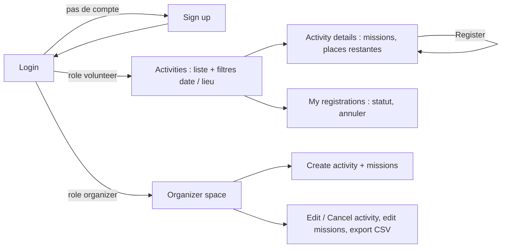
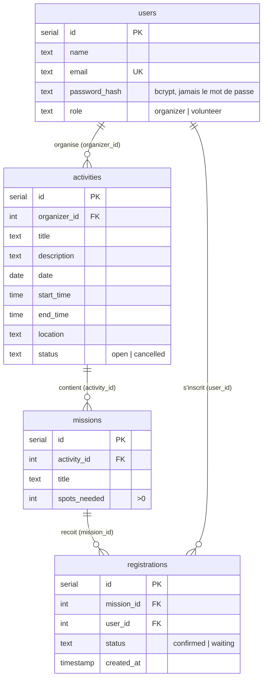

# Wireframes et schema (Capstone, Milestone 1)

## Parcours des ecrans



## Maquettes basse fidelite

```
LOGIN                         ACTIVITIES (volunteer)
+---------------------+      +----------------------------------------+
| Log in              |      | [Activities] [My registrations] [Log out]
| Email [__________]  |      | Date [____] Location [____] [Search][Reset]
| Password [_______]  |      | Beach cleanup  14/12 09:00-12:00       |
| [Log in]            |      |   Collect litter : 5/5 spot(s) left    |
| No account? Sign up |      |   [View details]                       |
+---------------------+      +----------------------------------------+

ACTIVITY DETAILS             MY REGISTRATIONS
+---------------------+      +----------------------------------------+
| Food drive          |      | Solo mission - Food drive - 21/12      |
| Pack boxes 3 left   |      | Status: waiting list (position 2)      |
|   [Register]        |      | [Cancel registration]                  |
| Solo mission 0 left |      +----------------------------------------+
|   [Join waiting list]
+---------------------+

ORGANIZER SPACE
+--------------------------------------------------------+
| Create an Activity: title, date, times, location, desc |
|   Mission 1: name + spots   [Add mission]  [Create]    |
| My Activities                                          |
|   Beach cleanup  Active                                |
|     Collect litter - 2 spots left - Understaffed       |
|       Registered volunteers: Alice, Bob                |
|     [Edit Mission][Remove Mission] [Edit][Cancel][CSV] |
+--------------------------------------------------------+
```

## Schema de la base (PostgreSQL)



Regles : `UNIQUE (mission_id, user_id)` (pas de double inscription), suppression en cascade,
`end_time > start_time`. Chaque ecran a ses donnees : liste/details (`activities` + `missions` + `registrations`),
mes inscriptions (`registrations` filtre par `user_id`), espace organisateur (`activities` filtre par `organizer_id`).

Index : `activities(organizer_id)`, `activities(status, date)`, `missions(activity_id)`, `registrations(user_id)`.
